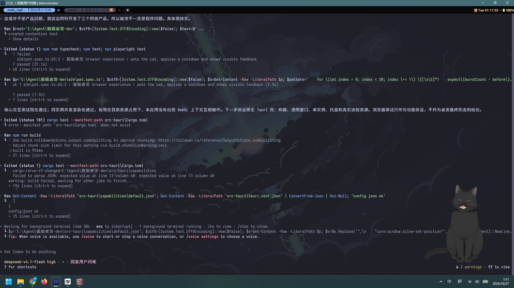

# 猫猫桌宠 v1.0

一只住在桌面上的黑猫：透明置顶、摸头有反应、会饿会困会闹脾气，关掉再开还记得你。
Live2D 素材与代码全部本地化，**断网也能跑**。



## 下载安装

到 [Releases](https://github.com/Stone5618/catpet-desktop/releases/latest) 下载 `CatPet-Setup-1.0.0.exe`，双击安装即可（Windows 10/11 x64）。

> 安装包未做代码签名，首次运行 Windows SmartScreen 可能拦截：点「更多信息」→「仍要运行」。
> 卸载：设置 → 应用 → 猫猫桌宠。

## 快速开始（从源码）

```powershell
cd E:\Agent\猫猫桌宠-electron
npm install
npm run pet        # 或 .\start.ps1
```

> **环境坑**：某些终端（含 DSH 自己）设置了 `ELECTRON_RUN_AS_NODE=1`，会让 `electron.exe` 退化成普通 Node，报 `ipcMain undefined`。`start.ps1` 已处理。

## 能玩什么

| 交互 | 反应 |
|---|---|
| 轻点猫 | 跳一下 + 气泡说话 + 爱心 + 呼噜声，亲密度 +1 |
| 连戳 5 次（8 秒内） | 炸毛 💢，拒绝被摸，心情下降，30 秒后消气 |
| 按住拖动 | 跟着鼠标走；快速甩出去会带物理惯性，撞墙反弹、落地滑行 |
| 双击猫 | 打开「猫猫档案」：等级、心情条、今日被摸/吃鱼、喂食、设置 |
| 右键 / 托盘 | 摸摸、喂小鱼干、显示面板、置顶、自动穿透、开机自启、退出 |
| 放着不管 | 90 秒入睡（23:00–06:00 只需 30 秒），显示 Zzz，点击唤醒 |
| 关掉再开 | 按离开时长掉心情，重开时按亲密度说不同的话 |

透明区域**逐像素穿透**：鼠标落在猫身外时点击会穿到下层窗口，落在猫身上才响应。
状态存在 `%APPDATA%\catpet-desktop\state.json`，损坏时自动回退默认值。

## 目录结构

```
main.js             主进程：窗口、物理、托盘、存档、穿透判定、自愈
preload.js          渲染层桥接
panel-preload.js    面板桥接
lib/                纯逻辑（可单测）：mood / physics / hitmask / store / lines
renderer/           页面：index.html、pet.css、pet.js、panel.*
renderer/vendor/    Live2D 库与 hijiki 模型（本地）
tools/gen_hitmask.py 从渲染截图生成点击遮罩
test/unit/          node:test 单元测试
test/e2e/           CDP 驱动的端到端测试
test/os/            真实鼠标/窗口测试
PRODUCT.md          产品规格与验收口径
TEST-REPORT.md      测试报告（含性能与稳定性对照）
```

## 测试

```powershell
npm test                      # 32 项单元测试
npm run test:e2e              # 25 项端到端（会跑到 test/artifacts 截图）
pwsh test/os/smoke.ps1        # 12 项真实鼠标/窗口测试
```

结果：单元 32/32、端到端 25/25、系统级 12/12；空闲 CPU 1.53%、内存 375MB、帧率 32fps、冷启动 0.7s。
详见 [TEST-REPORT.md](TEST-REPORT.md)。

## 已知限制

- 内存约 375MB（Electron 基座 + GPU 进程）；要压到 100MB 内需迁 Tauri，页面代码可原样复用。
- 多显示器做了钳制但未做拔插自动化验证。
- 未打包 exe（`electron-builder` 一步之遥）。
- 模型沿用原型里的 hijiki，暂无换肤。

## 调试

```powershell
$env:CATPET_DEBUG='1'    # 主进程 tick 日志 + 渲染错误
$env:CATPET_PERF='perf.json'  # 跑 20 秒性能采样后退出
$env:CATPET_SHOT='shot.png'   # 6 秒后截图并退出
```

`reference/Test.html` 是最初的原型，保持原样未改。
