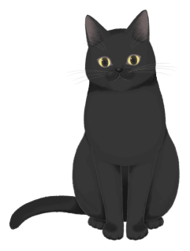

# 猫猫桌宠 v1.0

一只住在桌面上的猫：透明置顶、摸头有反应、会饿会困会闹脾气，关掉再开还记得你。

原生实现（C# + Win32 分层窗口），不是网页套壳；素材全部本地化，**断网也能跑**。



## 两只猫

| 黑猫 | 白猫 |
|---|---|
| hijiki | tororo |

右键菜单或设置面板一键切换，切换后窗口会按新素材重新贴合。

## 能玩什么

| 交互 | 反应 |
|---|---|
| 轻点猫 | 跳一下 + 气泡说话 + 爱心 + 喵叫/呼噜，亲密度 +1 |
| 连戳 5 次（8 秒内） | 炸毛，拒绝被摸，30 秒后消气 |
| 按住拖动 | 跟着鼠标走；快速甩出去带惯性，撞到屏幕边缘会弹、落地会滑 |
| 双击猫 | 打开「猫猫档案」：等级、亲密度、心情、今日统计、喂食、设置 |
| 右键 / 托盘 | 摸摸、喂小鱼干、打开面板、藏起、置顶、静音、换猫、退出 |
| 放着不管 | 你离开一会儿它就睡（白天 3 分钟、夜间 1 分钟没有键鼠输入），显示 Zzz；你回来动一下键鼠就醒 |
| 关掉再开 | 按离开时长掉心情，重开时按亲密度说不同的话 |

透明区域**逐像素穿透**：鼠标落在猫身外时点击会穿到下层窗口，落在猫身上才响应。
状态存在 `%APPDATA%\CatPet\state.json`，原子写入，损坏时自动回退默认值。

## 安装

到 [Releases](https://github.com/Stone5618/catpet-desktop/releases/latest) 下载 `CatPet-Setup-1.0.0.exe`，双击安装即可（Windows 10 1903+ / 11 x64）。

> 安装包未做代码签名，首次运行 Windows SmartScreen 可能拦截：点「更多信息」→「仍要运行」。
> 卸载：设置 → 应用 → 猫猫桌宠，会一并清除存档与开机自启项。

## 设置面板

双击猫打开：

- 等级 / 亲密度 / 心情 / 今日被摸与吃鱼
- 缩放：75% / 100% / 125% / 150%
- 静音、开机自启
- 换皮肤、摸摸头、喂小鱼干、藏起来、退出

## 可扩展

**加一只猫**（不用改渲染代码）：

1. 把 Live2D 模型放进 `assets/live2d/<名字>/`
2. 用 `tools/bake.js` 烘焙成帧素材（关键帧 + 差分，60fps 循环）
3. 菜单/面板加一项切换

**加一句台词**：`src/Core/Lines.cs` 对应数组里加一行，自动避免连续重复。

**加一个音效**：WAV 放进 `assets/sounds/`，在事件处调用 `Audio.Play("文件名")`。

## 从源码构建

依赖：.NET Framework 4.8（系统自带）、Roslyn `csc`。

```powershell
.\build.ps1 -Gui          # 产出 bin\CatPet.exe
.\bin\CatPet.exe --selftest   # 19 项自检
makensis installer.nsi    # 打安装包（需 NSIS）
```

## 技术说明

- Win32 分层窗口 + `UpdateLayeredWindow`，逐像素 alpha，命中测试由系统按 alpha 判定
- 独立渲染线程，60fps；缩放档按帧脏区重绘，只有出现粒子特效时才整幅重画
- 素材：Live2D 模型离线烘焙成 **CPF1** 帧容器（关键帧 + 差分，Deflate 压缩），运行时零解码开销

## 素材与授权

- 模型：Live2D 官方示例模型 `hijiki` / `tororo`，遵循其示例模型许可
- 音效：来自 freesound.org，均为 **CC0**（公共领域）
  - meow：*New Cat Meow 1* by steffcaffrey
  - meow2：*cat meow* by tuberatanka
  - hiss：*Cat Hissing* by aunrea
  - purr：*Cat purrs* by rainkencana
  - eat：*cat eating* by patchytherat
- 项目代码：[MIT](LICENSE)

## 已知限制

- 仅 Windows 10 1903+ / 11 x64
- 多显示器与高 DPI 场景未做自动化验证
- 非 100% 缩放时 CPU 占用会上升（缩放需要每帧重采样），低配机建议 100%

## 反馈

有问题或想法，欢迎开 [Issue](https://github.com/Stone5618/catpet-desktop/issues)。
